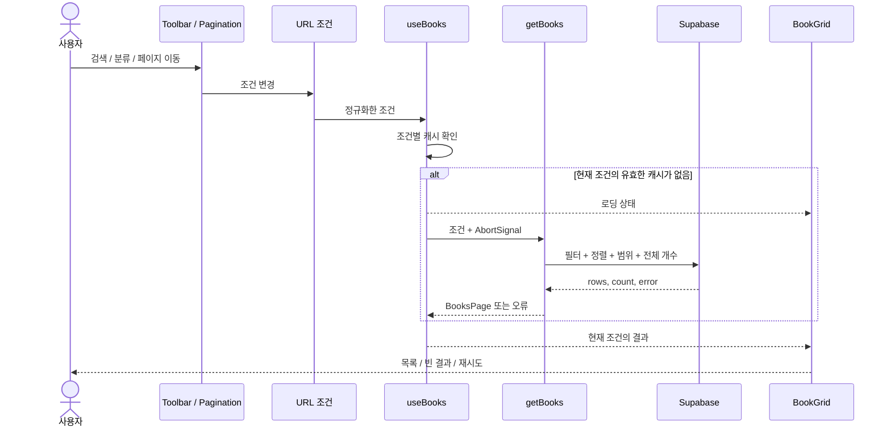

# Hidden Kice 아키텍처

Next.js 기반 교재 스토어의 모듈 책임, 데이터 흐름, 상태 관리와 검증 전략을 정의한다. 교재 조회는 Supabase를 사용하는 CSR로 구성하고, 검색 조건·서버 데이터·장바구니 상태를 분리한다.

구현 순서와 진행 상태는 [구현 계획](implementation-plan.md), 실제 토큰과 공통 UI의 적용 기준은 [디자인 시스템](design-system.md)에서 관리한다. 아래 구조와 동작은 구현 목표를 기준으로 기술한다. 교재의 Supabase CSR 조회, 검색·분류·페이지 이동과 URL 복원, 장바구니 담기·수량 관리·브라우저 보관을 구현했다. 캐러셀·SEO 확장은 후속 단계에 해당한다.

## 기능 범위

| 영역 | 기능 |
| --- | --- |
| 헤더 | 로고·메뉴, 스토어 활성 표시, 메뉴 hover 효과, 장바구니 열기 |
| 배너 | 5개 슬라이드, 자동·수동 이동, 현재 인덱스, 일시 정지·재개 |
| 교재 목록 | 검색, 전체·패스·단품 필터, 페이지 이동, 가격 표시 |
| 장바구니 | 담기, 수량 변경, 개별 삭제, 전체 비우기, 합계, 브라우저 보관 |
| 공통 UI | Pretendard, 디자인 토큰, 반응형 배치, 키보드 접근성 |
| SEO | 서버 메타데이터, canonical, 공유 미리보기, robots, sitemap |

상품 상세·인증·주문·결제·재고 관리는 기본 구현 범위에 포함하지 않는다. 헤더 메뉴와 알림·사용자 아이콘은 표시용 UI로 구성한다. 상품 카드 본문은 정보를 표시하고, 담기 버튼은 별도 동작으로 제공한다. 배너 CTA는 교재 목록으로 이동한다.

## 모듈 구조

```text
src/
├─ app/                          페이지 조립, Provider, 메타데이터
├─ styles/
│  └─ tokens.css                 기본 토큰과 의미 토큰
├─ features/
│  ├─ books/
│  │  ├─ api/
│  │  │  ├─ get-books.ts         목록 조회와 응답 변환
│  │  │  └─ get-books-by-ids.ts   ID 목록으로 현재 상품 조회
│  │  ├─ model/
│  │  │  ├─ book.ts              화면용 데이터 타입
│  │  │  ├─ catalog-params.ts    조회 조건 파싱과 정규화
│  │  │  ├─ use-catalog-params.ts URL 읽기와 변경
│  │  │  └─ use-books.ts         요청과 캐시 정책
│  │  └─ ui/                     목록, 카드, 검색·필터, 페이지 이동
│  └─ cart/
│     ├─ model/cart.ts            수량·합계·저장 형식 검증
│     ├─ model/cart-store.ts      복구·변경·보관과 구독
│     ├─ model/cart-provider.tsx  인스턴스 제공, React 구독, 담기 알림
│     ├─ model/use-cart-books.ts  패널의 현재 상품 정보 조회
│     └─ ui/                     담기 버튼, 헤더 버튼, 패널과 항목
├─ components/
│  ├─ layout/                    헤더와 푸터
│  ├─ ui/                        Button, IconButton, TextField, Badge
│  └─ home/                      배너 캐러셀
└─ lib/supabase/                 클라이언트와 DB 타입
public/images/books/            단품·패스 이미지
supabase/
├─ migrations/                  테이블, 제약, 권한 정책
├─ seed.sql                     상품 초기 데이터
└─ verify.sql                   데이터·권한·제약 확인
tests/
├─ unit/                        Vitest 단위 테스트
├─ e2e/                         Playwright 사용자 흐름 테스트
└─ live/                        실제 Supabase 연결 테스트
```

교재 탐색은 `features/books`, 장바구니는 `features/cart`가 소유한다. 화면에서 반복되는 표현만 공통 UI로 분리하고 검색 조건이나 가격 계산 같은 도메인 규칙은 기능 안에 둔다.

| 구성 요소 | 책임과 의존성 |
| --- | --- |
| app | 기능 조립과 Provider·Suspense 경계 배치 |
| BookCatalog | 조회 조건·결과를 UI의 props와 이벤트에 연결 |
| BookCard | 전달받은 Book 표시. SDK·라우터·조회 훅에 의존하지 않음 |
| useBooks | 조건별 요청과 캐시 관리. URL은 변경하지 않음 |
| getBooks | 정규화된 조건과 AbortSignal을 받아 조회. React·URL에 의존하지 않음 |
| lib/supabase | 연결과 DB 타입 제공. 기능 모듈을 import하지 않음 |

DB 응답의 snake_case 필드는 조회 경계에서 camelCase로 변환한다. UI에는 화면용 타입을 전달하므로 DB 스키마 변경이 표시 컴포넌트로 직접 전파되지 않는다. 별도의 범용 Repository나 공통 CRUD 계층은 두지 않는다.

## 렌더링과 상태 관리

헤더·배너·푸터와 메타데이터는 초기 문서에 포함하고, 교재는 브라우저에서 조회한 뒤 표시한다. 상품 데이터의 서버 조회나 prefetch는 사용하지 않는다. 상호작용이 필요한 컴포넌트에 Client Component 경계를 배치한다.

교재 영역은 `Providers → Suspense → BookCatalog`로 구성한다. Suspense의 초기 fallback과 실제 조회 중 화면은 동일한 카드 스켈레톤을 사용한다. 요청 성공·실패는 조회 훅의 결과로 처리한다.

| 상태 | 소유 위치 | 이유 |
| --- | --- | --- |
| 적용된 검색어·분류·페이지 | URL | 새로고침·공유·뒤로 가기에서 조건 복원 |
| 입력 중인 검색어 | 검색창 로컬 상태 | 입력과 조회 실행 시점 분리 |
| 상품·전체 개수·요청 상태 | TanStack Query | 조건별 캐시와 요청 수명 관리 |
| 장바구니 ID·수량 | cart 공유 상태와 localStorage | 화면 간 동기화와 브라우저 재실행 후 복구 |
| 패널·메뉴 열림 | 해당 UI 상태 | 조회 조건과 무관한 상호작용 |
| 열 개수·여백 | CSS | 화면 크기 변경과 조회 조건 분리 |

### 조회 조건

기본값은 검색어 없음, `kind=all`, `page=1`, 페이지 크기 12개다. URL에는 기본값을 생략할 수 있다. 검색어는 `q`를 사용한다. 예를 들어 `/?q=기하&kind=pass`는 상품명에 기하가 포함된 패스 상품의 첫 페이지를 뜻한다.

- Enter 또는 검색 버튼으로 검색어를 적용한다.
- 검색·분류 변경은 새 조건과 `page=1`을 한 번의 URL 변경으로 반영한다.
- X 버튼은 입력과 적용된 검색어를 비우고 페이지를 1로 되돌린다. 분류는 유지한다.
- 페이지 이동은 검색어와 분류를 유지하고 교재 영역으로 스크롤·포커스를 옮긴다.
- 사용자 조작은 `push`, 잘못된 조건이나 페이지 범위 보정은 `replace`를 사용한다.
- URL 변경 시 입력창도 적용된 검색어로 동기화한다.

페이지는 조회 offset까지 안전한 정수가 되는 양의 정수, 분류는 허용된 값으로 제한한다. 검색어는 앞뒤 공백을 제거하고 최대 100자로 제한한다. 중복 조건과 명시된 기본값은 정규화하며 다른 URL 파라미터와 hash는 보존한다.

`useSearchParams`로 URL을 구독하고 Next.js와 연동되는 `history.pushState`·`replaceState`로 변경한다. 클라이언트 조회 조건만 바뀌므로 페이지 전체를 다시 요청하지 않는다. 연속 조작 시에는 현재 브라우저 URL에서 최신 조건을 읽는다.

### 요청 흐름



조회 키는 `['books', 'list', { query, kind, page, pageSize: 12 }]`다. 캐시 신선도는 60초로 두며 창 포커스 복귀 시 자동 재조회와 TanStack Query·Supabase SDK의 자동 재시도는 끈다. SDK의 요청 제한 시간은 15초다. 실패 후에는 현재 조건으로 명시적으로 재시도한다.

`getBooks`는 필요한 컬럼과 정확한 전체 개수를 요청하고 상품명 부분 검색과 분류 조건을 적용한다. `sort_order`, `id` 순서로 정렬하며 조회 범위는 `시작=(page-1)×12`, `끝=시작+11`이다. 전체 개수는 페이지 범위 적용 전의 검색·분류 결과를 기준으로 한다.

상품명은 대소문자를 구분하지 않는 부분 검색이다. 조회 경계에서 정규식 특수문자를 이스케이프한 뒤 PostgREST의 `imatch`를 사용한다. 사용자가 정규식이나 와일드카드를 실행할 수 없으며 `%`, `_`, `*`, 역슬래시도 일반 문자로 검색한다.

조건이 바뀌면 이전 요청의 AbortSignal을 전달하고 새 조회 키의 결과를 구독한다. 다른 조건의 목록을 placeholder로 표시하지 않는다. 요청 취소와 별개로 결과를 조회 키별로 분리하여 늦은 응답이 현재 목록을 덮지 않도록 한다.

### 실패와 복구

| 상황 | 처리 |
| --- | --- |
| 데이터 없이 요청 중 | 검색·필터 유지, 카드 스켈레톤 표시 |
| 결과 0건 | 빈 결과와 조건 초기화 제공, 페이지 이동 숨김 |
| 데이터 없이 요청 실패 | 오류 안내와 재시도 |
| 캐시 갱신 실패 | 기존 결과 유지, 갱신 실패 안내와 재시도 |
| 마지막 페이지 초과 | 마지막 페이지로 URL 보정 후 조회 |
| 결과 0건이며 page>1 | page=1로 URL 정리 |
| 이미지 실패 | 영역 크기를 유지하는 대체 표시 |

PostgREST의 범위 초과 응답(`416`, `PGRST103`)에는 count가 없으므로 같은 검색·분류로 HEAD 요청을 보내 정확한 개수를 확인한다. 범위 초과일 때만 이 추가 요청을 수행하고 URL을 보정한 뒤 해당 페이지를 조회한다.

DB 오류나 누락된 count를 0건으로 변환하지 않는다. 캐시의 신선도 기간에는 서버 변경이 즉시 반영되지 않을 수 있다.

## 데이터 모델

`public.books`의 한 행은 목록에 표시하고 장바구니에 담을 수 있는 상품 하나다. 단품과 패스의 표시 필드가 같으므로 `kind`로 구분한다. `all`은 조회 조건에만 사용한다.

| 컬럼 | 타입과 제약 | 역할 |
| --- | --- | --- |
| id | uuid primary key | 상품 식별, 장바구니 참조 |
| title | 비어 있지 않은 text | 상품명과 검색 |
| kind | single 또는 pass | 분류 |
| cover_path | 비어 있지 않은 text | 공개 이미지 경로 |
| list_price | 0 이상 integer | 원 단위 정가 |
| sale_price | nullable integer, 0 이상·정가 이하 | 할인 판매가 |
| sort_order | integer not null | 노출 순서 |

표시 가격은 `salePrice ?? listPrice`다. 할인율은 정가가 0보다 크고 판매가가 정가보다 낮을 때 `round((정가 - 판매가) / 정가 × 100)`으로 계산한다. 할인율과 합계는 저장하지 않는다.

```ts
type BookKind = 'single' | 'pass';

type Book = {
  id: string;
  title: string;
  kind: BookKind;
  coverPath: string;
  listPrice: number;
  salePrice: number | null;
};

type CatalogParams = {
  query: string;
  kind: BookKind | 'all';
  page: number;
};

type BooksPage = {
  items: Book[];
  totalCount: number;
};
```

조회 계약은 `getBooks(params: CatalogParams, signal?: AbortSignal): Promise<BooksPage>`로 정의한다.

초기 데이터는 단품 12개와 패스 6개로 구성한다. 기본 목록은 12개·6개의 두 페이지다. 고정 ID와 upsert로 seed 재실행 시 중복을 방지한다. 단품과 패스는 각각 다음 이미지를 사용하며 경로는 DB 응답에 포함한다.

- 단품: `/images/books/hidden-kice-book-single.webp`
- 패스: `/images/books/hidden-kice-book-pass.webp`

이미지 영역은 일정하게 유지하고 `object-fit: contain`으로 비율을 보존한다. 대체 텍스트는 각 상품명을 사용한다.

패스의 구성 교재 관계와 구매 권한은 모델에 포함하지 않는다. 현재 데이터 규모에서는 별도 검색 인덱스를 추가하지 않으며, 데이터 증가 시 실제 쿼리 계획을 기준으로 검토한다.

## 장바구니

상품 이미지 우측 하단의 버튼을 클릭하거나 탭하면 담긴다. 데스크톱에서는 hover·focus 시 버튼을 표시하고, hover를 지원하지 않는 장치에서는 항상 표시한다. 작은 아이콘과 실제 조작 영역을 분리하여 키보드·터치 조작을 지원한다.

`AddToCartButton`은 상품 ID와 제목을 전달받고, `BookCard`는 장바구니의 저장 규칙을 직접 다루지 않는다. 헤더의 `CartButton`과 담기 버튼은 같은 Provider의 상태를 구독한다.

같은 상품을 다시 담으면 중복 항목 없이 수량만 1 증가시킨다. 상태 반영 후 처음 담기는 “장바구니에 담았습니다”, 추가 담기는 “수량이 추가되었습니다” 토스트를 표시한다.

수량은 1~99개를 기본 정책으로 두고 최소값에서 감소를 비활성화한다. 최대값에서는 추가 담기·증가를 제한하고 한도를 안내한다. 개별 삭제와 전체 비우기를 별도로 제공하며 헤더 배지는 전체 수량을 표시한다. 수량 한도는 UI 정책으로 실제 재고를 의미하지 않는다.

### 보관과 복구

localStorage에는 버전, 상품 ID와 수량만 저장한다. 상품 정보와 계산된 합계는 저장하지 않는다.

```ts
type PersistedCart = {
  version: 1;
  items: Array<{ bookId: string; quantity: number }>;
};
```

`CartProvider`마다 저장소 인스턴스를 만들고 `useSyncExternalStore`로 상태 변경을 구독한다. 서버와 최초 hydration에는 같은 빈 스냅샷을 사용한다. mount 후 localStorage를 한 번 읽으며, 복구 완료 전에는 버튼과 저장을 비활성화해 빈 장바구니가 기존 데이터를 덮지 않도록 한다.

저장 키는 `hidden-kice.cart.v1`이다. 손상된 JSON·지원하지 않는 버전은 빈 상태로 정리하고 안내한다. 항목별 UUID·1~99의 정수 수량을 검증해 잘못된 항목만 제외한다. 중복 ID는 수량을 합치되 99개를 넘지 않게 하고 ID는 소문자로 통일한다. 검증 후에만 정리된 형식을 저장한다.

사용자 변경은 메모리와 localStorage에 즉시 반영한다. 저장소 접근 실패 시 현재 화면의 상태는 유지하고 토스트·패널에서 보관 실패를 안내한다. 저장 실패를 상품 조회 실패와 섞지 않는다.

보관 범위는 같은 origin의 같은 브라우저 프로필이다. 기기 간 동기화나 브라우저 데이터 삭제 이후 복구는 지원하지 않는다.

### 가격과 패널

장바구니는 네이티브 `dialog.showModal()`로 오른쪽 패널에 열리며 모바일에서는 화면 너비를 사용한다. 배경의 조작과 스크롤을 막고 닫기·Escape·배경 클릭을 지원한다. Tab·Shift+Tab은 패널의 첫·마지막 버튼 사이를 순환한다. 닫은 뒤에는 열기 버튼으로 포커스를 돌려준다. 목록의 검색·분류·페이지 상태는 유지한다.

패널이 열릴 때 `useCartBooks → getBooksByIds → Supabase` 순서로 정렬한 ID 목록을 한 번에 조회한다. 조회 키는 `['books', 'cart', ids]`이며 목록 검색·분류·페이지 조건과 분리한다. `refetchOnMount: 'always'`로 다시 열 때마다 현재 정보를 확인한다. 수량만 바꾸면 조회 키가 유지되어 추가 요청 없이 금액을 계산한다. ID가 바뀌거나 패널이 닫히면 이전 요청에 취소 신호를 전달한다.

목록에 없는 상품도 조회 대상에 포함한다. 조회·갱신 중에는 이전 금액을 합계로 표시하지 않으며 오프라인에서는 연결 대기 상태를 표시한다. 실패하면 ID·수량을 유지하고 현재 조건으로 재시도한다. 자동 재시도와 창 포커스·재연결에 따른 별도 재조회는 끈다.

항목 금액은 `(salePrice ?? listPrice) × quantity`, 합계는 유효한 항목 금액의 합이다. 조회 실패는 재시도 상태로 표시하며 0원으로 대체하지 않는다. 존재하지 않는 상품은 사용할 수 없는 항목으로 표시하고 삭제를 제공한다. 누락 항목이 있으면 소계와 누락 안내를 구분한다. 이 금액은 장바구니 표시용이며 결제 가격 확정 로직은 포함하지 않는다.

## 디자인 시스템과 반응형

전체 UI는 Pretendard를 사용한다. 기본 토큰은 색상 팔레트·간격·타이포·모서리·그림자를 정의하고, 의미 토큰은 브랜드·텍스트·배경·테두리·가격 강조·포커스의 역할을 정의한다.

공통 컴포넌트는 의미 토큰을 소비한다. Button, IconButton, TextField, Badge에 실제 화면에서 필요한 크기·변형과 hover·focus-visible·disabled·selected 상태를 정의한다. 상품 카드와 검색·필터 조합은 기능 UI에서 공통 요소를 조합한다.

SVG는 viewBox를 보존하고 크기 토큰과 currentColor로 표시한다. 카드와 배너의 이미지 영역은 미리 확보하여 로딩에 따른 레이아웃 이동을 줄인다.

1440px 데스크톱의 4열 그리드를 기준으로 구현하고 중간 화면 3열·좁은 화면 2열로 조정한다. 페이지 크기는 12개로 유지한다. 390px·360px에서 상품명, 검색창, 헤더, 장바구니 패널의 가로 넘침을 확인한다.

디자인 시스템 소개 페이지는 선택 확장 항목이다. 추가 시 실제 토큰과 공통 컴포넌트를 재사용하며 검색 색인과 sitemap에서 제외한다.

## 캐러셀과 SEO

배너는 동일 이미지를 사용하는 5개 슬라이드로 구성하며 실제 인덱스를 표시한다. 자동 재생 간격은 5초를 기본값으로 두고 이전·다음 이동과 정지·재개를 제공한다. hover·키보드 포커스 진입 시 일시 정지하며 동작 줄이기 설정에서는 자동 재생을 시작하지 않는다.

| SEO 항목 | 정책 |
| --- | --- |
| 제목·설명 | 서버에서 제공하고 목록 페이지 번호를 구분 |
| canonical | 최종 배포 주소 기준. `/`와 `/?page=2` 구분 |
| 검색·분류 URL | 정규화된 자기 URL을 canonical로 사용, noindex·follow 적용 |
| 공유 미리보기 | 제목·설명·이미지와 절대 URL 제공 |
| robots·sitemap | 구현된 공개 경로만 포함, Preview 배포는 색인 제외 |
| 문서 구조 | lang=ko, 의미 있는 제목·영역 구조, 이미지 대체 텍스트 |
| 페이지 이동 | 실제 href를 가진 링크로 구현 |

메타데이터를 위해 서버에서 상품을 중복 조회하지 않는다. noindex를 읽을 수 있도록 해당 탐색 URL의 크롤링을 robots.txt로 차단하지 않는다. 상품 상세·주문 기능에 대한 URL과 구조화 데이터는 포함하지 않는다.

CSR 상품 본문은 JavaScript 렌더링 여부에 따라 검색 노출에 제약이 있다. 페이지 메타데이터와 공유 미리보기를 제공하되 상품별 색인을 보장하지 않는다. 상품 검색 유입이 필요해지면 공개 상세 페이지와 서버 렌더링을 별도로 검토한다.

## 데이터 접근과 배포

브라우저는 `NEXT_PUBLIC_SUPABASE_URL`과 `NEXT_PUBLIC_SUPABASE_PUBLISHABLE_KEY`로 조회한다. `books`는 공개 상품 전용 테이블이며 RLS와 테이블 권한을 함께 적용한다. anon에는 SELECT만 허용하고 INSERT·UPDATE·DELETE 권한은 부여하지 않는다. secret key와 service role key는 클라이언트와 저장소에 포함하지 않는다.

migration과 seed는 관리 권한으로 적용하고 앱은 조회만 수행한다. GitHub에는 소스·공개 자산·migration·seed·테스트·환경변수 예시를 포함한다. Vercel에는 환경별 설정을 적용하며 canonical과 공유 URL은 최종 배포 주소로 구성한다.

## 검증 전략

| 검증 | 범위 |
| --- | --- |
| Vitest | URL 조건, 장바구니 변경, 저장 데이터 검증, 가격·합계·할인율 |
| Playwright E2E | 검색·필터·페이지 이동, 토스트·패널·보관, 캐러셀, 접근성·반응형·SEO |
| Playwright 실제 연결 | Supabase 요청·응답과 화면의 상품명·가격 연결 |
| 별도 확인 | 공개 키 권한, 타입 검사, 린트, 프로덕션 빌드, 시안 비교 |

Vitest는 순수 규칙의 입력·기대 결과와 경계값을 검사한다. Playwright는 검색 조건 변경부터 결과 표시까지, 담기부터 브라우저 재실행 후 복구까지의 사용자 흐름을 검사한다.

일반 E2E는 테스트마다 상태를 격리하고 지연·실패·가격 변경 응답을 제어한다. 브라우저 재시작 테스트는 전용 임시 프로필을 닫았다가 같은 프로필과 origin으로 다시 실행한다. 저장 상태를 주입하는 검사와 실제 재시작 검증을 구분한다.

실제 연결 테스트에서는 상품 API를 대체하지 않는다. mock 기반 테스트, 실제 DB 연결, 권한 확인의 결과를 구분하여 기록한다. 전체 E2E는 프로덕션 빌드에서도 실행하고 배포 후 핵심 흐름을 다시 확인한다.

주요 완료 기준은 다음과 같다.

- 전체 18개·단품 12개·패스 6개의 조회 결과와 페이지 개수가 일치한다.
- 검색·필터 변경 시 1페이지로 이동하고 새로고침·뒤로 가기로 조건이 복원된다.
- 지연된 이전 응답이 현재 결과를 덮지 않으며 실패 후 같은 조건으로 재시도한다.
- 장바구니 재담기·수량·합계·삭제가 일치하고 재실행 후 항목이 복원된다.
- 패널을 다시 열면 가격을 조회하고 실패·누락 상태를 구분한다.
- 캐러셀 자동·수동 이동과 정지 동작, 키보드 조작, 모바일 배치가 동작한다.
- 서버 HTML의 메타데이터와 canonical, robots·sitemap 응답이 정책과 일치한다.

## 변경 시 수정 범위

| 변경 | 수정 위치 | 유지하는 경계 |
| --- | --- | --- |
| 카드 디자인 | BookCard·BookGrid | 조회 조건과 API 계약 |
| 정렬 추가 | 조건 모델·Toolbar·조회 키·getBooks | 카드 표현과 DB 연결 |
| 교재 상세 추가 | books의 조회·UI와 새 route | 목록·상세의 요청 상태 분리 |
| 장바구니 보관 방식 변경 | cart의 저장 경계 | 교재 목록과 장바구니 상태 분리 |
| 조회 서비스 변경 | getBooks와 응답 변환 | 같은 계약을 제공하는 범위의 UI |
